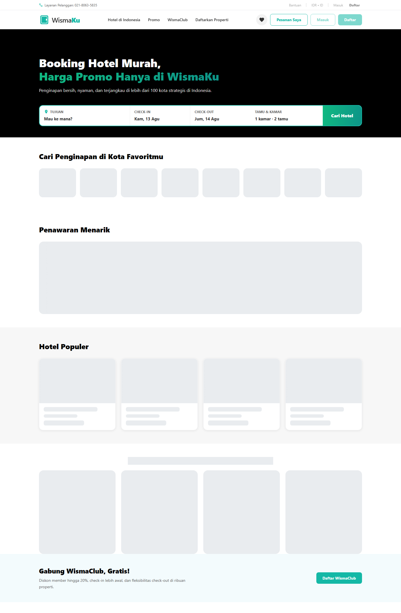

# WismaKu — Website Prototype Penginapan ala RedDoorz

Website demo tiruan pemesanan penginapan (OTA) dengan tampilan dan alur mirip RedDoorz. Dibangun sebagai proyek pembelajaran frontend: **React + Vite**, arsitektur siap-backend, dan mode mock untuk demo tanpa server.



## Fitur

- Pencarian penginapan: destinasi, tanggal (date range picker), kamar, tamu
- Filter & sortir hasil: amenities, rentang harga, rating, harga/rating
- Halaman detail hotel: galeri foto + lightbox, tipe kamar, ulasan tamu, kebijakan
- Pemesanan dengan kalkulasi harga: kupon diskon, diskon member 10%
- Kupon validasi (misl. `WISMA20`), diskon member WismaClub
- Halaman pemesanan (riwayat + pembatalan) dan halaman favorit
- Pendaftaran member WismaClub & partner penginapan (modal + validasi)
- Mode **mock** (localStorage) atau **API sungguhan** cukup ganti satu env

## Teknologi

| Lapisan  | Pilihan                                   |
| -------- | ----------------------------------------- |
| UI       | React 18, React Router 7, Vite 7          |
| Tanggal  | date-fns, react-day-picker                |
| Validasi | Zod                                       |
| Gaya     | Tailwind CSS v4 (design tokens, @utility) |
| Kualitas | ESLint 10, Prettier 3                     |

## Menjalankan Lokal

```bash
npm install
npm run dev
```

Buka `http://localhost:5173`. Mode mock aktif secara default (data lokal + localStorage).

### Konfigurasi lingkungan (`/.env`)

```ini
# true = pakai data lokal (src/data + localStorage), false = panggil API backend
VITE_USE_MOCK=true

# Base URL API backend (kosongkan jika VITE_USE_MOCK=true)
VITE_API_URL=
```

Arsitektur service (`src/services/*`) sudah siap dihubungkan ke API: setiap fungsi
memiliki cabang `request()` untuk mode non-mock.

## Struktur Proyek

```
src/
  components/   # Komponen UI (Header, Hero, HotelCard, Modal, ...)
  pages/        # HomePage, HotelDetailPage, BookingsPage, FavoritesPage
  hooks/        # useCatalog (data fetching), useFocusTrap, usePageMeta
  services/     # hotel, booking, favorite, member, coupon, api
  data/         # Data mock (hotels, cities, coupons)
  schemas/      # Validasi Zod kontrak payload
  utils/        # searchParams, filtering, format, image
  styles/       # tailwind.css (tokens, @utility btn*, CSS datepicker & slider)
```

## Build & Deploy

```bash
npm run build      # output di dist/
npm run preview    # pratinjau build lokal
npm run lint       # ESLint
npm run test       # Vitest (unit test utils & services)
npm run format     # Prettier
```

Push ke `main` lalu import repo di
[Vercel](https://vercel.com) (preset Vite otomatis: build `npm run build`, output `dist/`).
`vercel.json` berisi rewrite agar deep link SPA berfungsi.

## Demo

Tersedia setelah deployment pertama berjalan: `https://wismaku-demo.vercel.app/`
